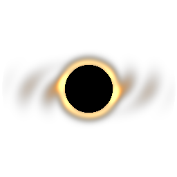

# Theoretical Sciences

**An endgame tech mod at the edge of theoretical physics — NeoForge 1.21.1.**

Entangle qubits, trap antimatter, condense Bose-Einstein matter, forge micro black holes, fold space into tesseracts,
harvest the quantum foam, prove theorems to unlock machines, and finally take apart and rebuild the Omnipotence Core
at the end of everything.



## Content

* **78 machines, 37 of them multiblocks.** The big ones run on real physics models: the operator sets fields,
  temperatures and beam energies on a console, and each recipe has its own unique hazardous environment to perform. Tuned
  multiblocks drift and wear their containment, overclock and run parallel recipes accelerates it. A failing containment releases
  hazards.
* **A research tree of 148 entries.** Many are unlocked by solving a derivation puzzle (build the equation, find the
  answer) with values that differ in every world. Each equations are exact, or derivative of its real life equivalent.
* **Ten dimensions:** Representing the concepts of the Universe, the Quantum Foam, the Bulk, Hyperdimensional Reality, the Platonic Realm,
  the Transfinite Hierarchy, the Antiverse, black and white hole interiors, the Living Proof and the Transcendental.
  Each has its ownlaws, creatures and soundtrack.
* **The endgame:** the Omnilex Engine's impossible recipe opens the gate to Transcendental; Alpha Omega awaits in the Living
  Proof; the Omnipotence Core can materialize and forge anything — until its Shutdown Sequence, the Sundering and the
  Rekindling. Powerful tools, armour and weapons that run on Eschaton Charge, and an Omnipotence Core of your
  own that must be attuned to every place it stands in, are within your grasp, at a steep price and cost.
* **Singularities for every mod:** every ingot of every installed mod gets one automatically.
* **The Quantum Codex:** the mod's own guide book, revealed as you progress, with every recipe in it.
* **874 items and blocks, 48 fluids, 25 creatures**, all with generated art and a synthesised soundtrack.
* **Extreme costly, deeply intertwined recipes**, that puts the most costly items you have seen elsewhere to shame.
* **Living, automatic Creative Mode items recipe support**: Creative-only items are automatically detected from your other installed mods,
  with an endgame recipe at the Omnipotence Core’s Forge, built from that mod’s own most advanced items.
  For modpack authors, this can be done with just a tag addition for any that escapes detection.

## Compatibility

* No mixins, no access transformers, no coremods, no required dependencies.
* Standard FE, item and fluid capabilities on every machine and on Interface Ports.
* Optional integrations: **JEI** or **EMI** (every recipe, 3D structure previews), **Jade** (machine status, recipe
  and progress), **KubeJS** (see below), **AE2** (Interface Ports automatically detects and registers as part of ME network).

## For modpack developers

Recipes, research, machine numbers, structure parts, the Forge and singularities can all be changed with a plain
datapack or with KubeJS:

* **[docs/DATAPACKS.md](docs/DATAPACKS.md)** — every recipe format and data folder, with examples.
* **[docs/KUBEJS.md](docs/KUBEJS.md)** — the same from KubeJS scripts, plus events and helpers.

Addons are welcome: **[docs/ADDONS.md](docs/ADDONS.md)** (and the licence below).

Server config: `config/theoreticalsciences-common.toml` (energy, duration and ingredient multipliers, drift and wear,
research and puzzles, singularities, creative duplicators, Chronal Accelerator). Client config:
`config/theoreticalsciences-client.toml` (gravitational lensing, structure distortion, sky, particles).

Commands (operators):

```
/theoreticalsciences research grant|revoke <player> <id|*>
/theoreticalsciences research list <player>
/theoreticalsciences insight add <player> <amount>
```

## Building

See **[docs/BUILDING.md](docs/BUILDING.md)**.

## License

Theoretical Sciences is made by **Innight** and released under the [MIT License](LICENSE).

You're free to use, modify, copy and share it: in modpacks, videos and streams, addons, ports,
or your own projects, including commercial ones. The only requirement is that the copyright
notice and the MIT License text stay with any copy or substantial portion of the mod.

**Appreciated, not required:**

- a link back to the mod's [CurseForge page](<your CurseForge link>) when you feature or redistribute it;
- credit to Innight in the description and mod info of addons and ports;
- downloading the mod from CurseForge, which supports its development.

Minecraft is a trademark of Mojang Studios. Theoretical Sciences is not affiliated with or endorsed by Mojang or Microsoft.
